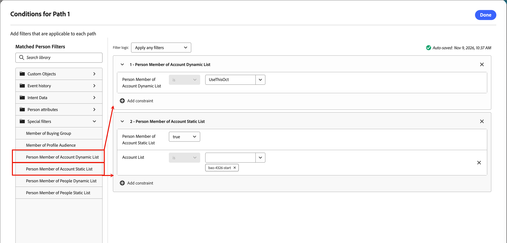

# Uso de listas de cuentas en recorrido

Existen varias formas de incorporar listas de cuentas activas (publicadas) en los recorridos de cuenta.

## Nodo de audiencia de cuenta

Todos los recorridos de la cuenta comienzan con un [_nodo de audiencia de la cuenta_](../journeys/account-audience-nodes.md). Cuando configura este nodo para que utilice una lista de cuentas, las cuentas de miembro se mueven a través del recorrido cuando se activa (publica).

1. Seleccione la opción **[!UICONTROL Lista de cuentas]** para el nodo de inicio _Audiencia de cuentas_.

   {width="500"}

1. Haga clic en **[!UICONTROL Agregar lista de cuentas]**.

1. Seleccione la casilla de la lista de cuentas y haga clic en **[!UICONTROL Guardar]**.

   {width="600" zoomable="yes"}

## Tomar un nodo de acción: agregar a la cuenta

**_Solo listas de cuentas estáticas_**

Dentro de un recorrido de cuentas, agregue cuentas a una lista de cuentas estáticas usando [un nodo _Realizar una acción_](../journeys/action-nodes.md).

Por ejemplo, tiene una ruta de recorrido por la que envía un correo electrónico y algunas cuentas realizan varias acciones como respuesta. Considera esta actividad como un punto de cualificación en el recorrido. Con la calificación, desea agregarlos a una lista de cuentas que se utiliza como audiencia para otro recorrido con un flujo diferente para cuentas calificadas.

>[!NOTE]
>
>Si una cuenta ya está en la lista cuando se ejecuta el nodo, la acción se ignora.

1. Seleccione la opción _[!UICONTROL Acción en]_ **[!UICONTROL Cuentas]**.

1. Para _[!UICONTROL Acción en las cuentas]_, elija **[!UICONTROL Agregar a la lista de cuentas]**.

   {width="500"}

1. Para **[!UICONTROL Seleccionar lista de cuentas estáticas activas]**, elija la lista de cuentas a la que desea agregar cuentas.

   {width="500"}

## Tomar un nodo de acción: eliminar de la cuenta

**_Solo listas de cuentas estáticas_**

Dentro de un recorrido de cuentas, quita cuentas de una lista de cuentas estáticas usando [un nodo _Realizar una acción_](../journeys/action-nodes.md).

Por ejemplo, tiene una ruta de recorrido por la que envía un correo electrónico y algunas cuentas realizan varias acciones como respuesta. Considera esta actividad como un punto de cualificación en el recorrido. Con esta calificación, desea eliminarlos de una lista de cuentas. Esta lista se utiliza como audiencia de otro recorrido que envía correos electrónicos adicionales para que no duplique las comunicaciones de calificación.

>[!NOTE]
>
>Si una cuenta no está en la lista donde está programada para su eliminación, se omite la acción.

1. Seleccione la opción _[!UICONTROL Acción en]_ **[!UICONTROL Cuentas]**.

1. Para _[!UICONTROL Acción en cuentas]_, elija **[!UICONTROL Quitar de la lista de cuentas]**.

   {width="500"}

1. Para **[!UICONTROL Seleccionar lista de cuentas estáticas activas]**, elija la lista de cuentas a la que desea quitar cuentas.

   {width="500"}

## Nodo de rutas divididas: miembro de cuenta de la lista de cuentas {#split-paths-account-member-of-account-list}

**_Solo recorridos de cuenta_**

Use el filtro _[!UICONTROL Account Member of Account List]_ en un nodo [_Split paths_](../journeys/split-merge-paths-nodes.md#add-a-split-path-by-account-node) que se divide por cuentas. La cuenta es o no es miembro de una o varias de las listas de cuentas seleccionadas. Para incluir cuentas en las listas, establezca la pertenencia en `true` o en `false` para excluirlas.

Para excluir cuentas de una lista de bloqueados, agregue el filtro _[!UICONTROL Account Member of Account List]_, establezca la pertenencia a `false` y seleccione la lista.

1. Vaya al mapa del recorrido.

1. Haga clic en el icono de signo más ( **+** ) en una ruta y elija **[!UICONTROL Dividir rutas]**.

1. En las propiedades del nodo a la derecha, elija **[!UICONTROL Cuentas]** para la división.

1. Para definir una condición para _[!UICONTROL Ruta 1]_, haga clic en **[!UICONTROL Aplicar condición]**.

1. Defina el filtro de lista de cuentas.

   * En el editor de condiciones, expanda la carpeta _[!UICONTROL Filtros especiales]_ y arrastre el filtro **[!UICONTROL Lista de miembros de cuenta]** al área de trabajo de condiciones.

   * Para incluir cuentas en las listas, establezca la pertenencia en `true` o en `false` para excluirlas.

   * Seleccione una o varias listas de cuentas.

   {width="700" zoomable="yes"}

   Puede combinar el filtro de pertenencia a una lista de cuentas con otros filtros de cuentas y elegir hacer coincidir todas las condiciones o cualquier condición. Refine las condiciones aplicando la **[!UICONTROL lógica de filtro]** en la parte superior.

1. Haga clic en **[!UICONTROL Finalizado]**.

Continúe configurando el nodo de ruta de acceso dividida como se describe en [Agregar una ruta de acceso dividida por nodo de cuenta](../journeys/split-merge-paths-nodes.md#add-a-split-path-by-account-node).

## Nodo de rutas divididas: persona miembro de la lista de cuentas {#split-paths-member-of-account-list}

**_Solo recorridos de personas_**

Use los filtros de pertenencia a listas de cuentas en un nodo [_Split paths_](../journeys/split-merge-paths-nodes.md) de un recorrido de persona para enrutar a las personas en función de si su cuenta es miembro de una lista de cuentas. Hay dos filtros disponibles:

| Filtro | Descripción |
| ------ | ----------- |
| [!UICONTROL Lista dinámica de miembros de persona de la cuenta] | La cuenta de la persona es o no miembro de una o más listas de cuentas dinámicas. |
| [!UICONTROL Lista estática de miembros de persona de la cuenta] | La cuenta de la persona es o no miembro de una o más listas de cuentas estáticas. |

Para excluir a personas de cuentas incluidas en la lista de bloqueados de una ruta de acceso de referencia, agregue el filtro _[!UICONTROL Person Member of Account Static List]_, establezca el operador en `is not` y seleccione la lista.

1. Vaya al mapa del recorrido.

1. Haga clic en el icono de signo más ( **+** ) en una ruta y elija **[!UICONTROL Dividir rutas]**.

1. Para definir una condición para _[!UICONTROL Ruta 1]_, haga clic en **[!UICONTROL Aplicar condición]**.

1. Definición del filtro de lista de cuentas

   * En el editor de condiciones, expanda la carpeta _[!UICONTROL Filtros especiales]_ y arrastre el filtro **[!UICONTROL Miembro de persona de la lista dinámica de la cuenta]** o **[!UICONTROL Miembro de persona de la lista estática de la cuenta]** al área de trabajo de condiciones.

   * Para incluir a personas cuya cuenta está en la lista, establezca el operador en `is` o en `is not` para excluirlas.

   * Seleccione una o varias listas de cuentas.

     {width="700" zoomable="yes"}

   Puede combinar los filtros de pertenencia a listas de cuentas con otros filtros de personas y elegir hacer coincidir todas las condiciones o cualquier condición. Refine las condiciones aplicando la **[!UICONTROL lógica de filtro]** en la parte superior.

1. Haga clic en **[!UICONTROL Finalizado]**.

Continúe configurando el nodo de ruta de acceso dividida como se describe en [Agregar una ruta de acceso dividida por nodo de personas](../journeys/split-merge-paths-nodes.md#add-a-split-path-by-people-node).
