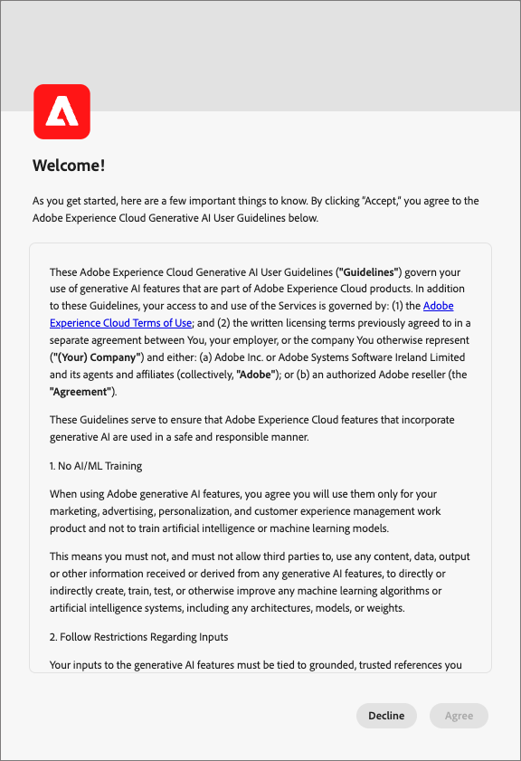

# Funciones de IA en Journey Optimizer B2B Edition

Use las capacidades de IA en [!DNL Adobe Journey Optimizer B2B Edition] para generar contenido, explorar el conocimiento del producto y obtener información operativa.

>[!IMPORTANT]
>
>Se requiere un acuerdo con las [directrices de usuario](https://www.adobe.com/es/legal/licenses-terms/adobe-gen-ai-user-guidelines.html){target="_blank"} para poder usar las capacidades de IA en [!DNL Journey Optimizer B2B Edition]. Este acuerdo también contiene el acuerdo de versión beta pública para que pueda utilizar las funciones adicionales habilitadas para IA a medida que se vayan implementando.

+++Ver la interfaz de acuerdos de usuario

+++

## Usar la aplicación [!DNL Coworker] {#coworker-app}

Usar la interfaz de aplicación [!DNL CX Enterprise Coworker] para todos los flujos de trabajo de chat que no sean la generación de contenido. Haga preguntas sobre el producto, explore las perspectivas operativas y utilice [aptitudes de recorrido](../agents/journey-agent.md) y [aptitudes de audiencia para cuentas B2B y personas](../agents/audience-agent-b2b.md). La generación de contenido permanece disponible en [!DNL Journey Optimizer B2B Edition].

Para obtener instrucciones sobre cómo abrir la aplicación, iniciar conversaciones y utilizar características de chat, consulta la [guía de la interfaz de CX Coworker](https://experienceleague.adobe.com/es/docs/coworker/content/chat/ui-guide){target="_blank"}.

Considere qué tipo de consulta necesita antes de enviar una consulta de chat de [!DNL Coworker].

### Conocimiento del producto

El conocimiento del producto hace referencia a conceptos y temas basados en la documentación de [!DNL Journey Optimizer B2B Edition] en [!DNL Adobe Experience League]. Las preguntas sobre conocimientos del producto se pueden especificar en los siguientes subgrupos:

| Conocimiento del producto | Ejemplos |
| --- | --- |
| Aprendizaje puntual | <li>¿Qué es un grupo de compra? <li> ¿Desea mostrar un ejemplo de una plantilla de funciones de grupo de compra? |
| Descubrimiento abierto | <li>¿Cuáles son los pasos para crear grupos de compra? <li>¿Cómo utilizo los campos personalizados en una plantilla de funciones de grupo de compra? |
| Resolución de problemas | <li>¿Por qué no se crearon los grupos de compra para mi recorrido? <li>¿Por qué no puedo encontrar eventos de experiencia para escuchar en el recorrido? |

### Datos operativos

_Datos operativos_ se refieren a respuestas que [!DNL Coworker] genera acerca de sus objetos de metadatos (atributos, audiencias de cuenta, flujos de datos, conjuntos de datos, destinos, recorridos de cuenta, esquemas, fuentes, plantillas de grupos de compras e intereses de soluciones). Estas perspectivas incluyen recuentos, búsquedas e impacto de linaje. No buscan ningún dato dentro de la zona protegida.

* ¿Qué audiencia de cuenta tiene el tamaño de audiencia más grande y cuál es ese tamaño?
* ¿Cuántas audiencias de cuenta nunca se han utilizado en ningún recorrido?
* ¿Qué recorridos activos usan el interés de la solución _x_?

Puede hacer [!DNL Coworker] preguntas sobre sus perspectivas operativas en los siguientes dominios:

| Dominio | Metadatos admitidos | Metadatos no admitidos |
| --- | --- | --- |
| Atributos/campos | <li>Búsqueda de nombre de atributo <li>Atributo: relación de esquema <li>Atributo: relación de conjunto de datos <li>Atributo: relación de audiencia <li>Atributo: relación de destino | <li>Clase de atributo <li>Auditoría <li>Estado de obsolescencia <li>Etiquetas <li>Valor almacenado en atributos |
| Audiencias de cuenta   **_Note:_** En el contexto [!DNL Journey Optimizer B2B Edition], el chat de [!DNL Coworker] solo puede responder preguntas de audiencia para Audiencias de cuenta. En el contexto [!DNL Adobe Experience Platform], el chat de [!DNL Coworker] solo puede responder preguntas para audiencias de personas. | <li>Recuento de público <li>Tipo de audiencia (flujo continuo o por lotes) <li>Fechas de creación/modificación <li>Estado de activación <li>Recuento de miembros <li>Duplicar audiencias <li>Búsqueda de nombre e ID | <li>Solapamientos de público <li>Activación de públicos <li>Auditoría <li>Crear/modificar <li>Etiquetas <li>Tendencias de cualificaciones de miembros |
| Flujos de datos | <li>Recuentos de flujo de datos <li>Estado de flujo de datos <li>Flujo de datos: relación de conjunto de datos <li>Flujo de datos: relación de origen | <li>Creación/modificación <li>Relaciones entre flujo de datos y lotes <li>Ingesta de recuento de perfiles |
| Conjuntos de datos | <li>Recuento de conjuntos de datos <li>Estado de habilitación de perfil <li>Fecha de creación/modificación <li>Conjunto de datos: relación de esquema <li>Conjunto de datos: relación de audiencia <li>Conjunto de datos: relación de atributos <li>Conjunto de datos: relación de flujo de datos <li>Búsqueda de nombres <li>Búsqueda de nombre e ID | <li>Auditoría <li>Creado por <li>Conjunto de datos: relación por lotes <li>Creación/modificación de conjuntos de datos <li>Tamaño del conjunto de datos <li>Número de perfiles <li>Número de filas <li>Búsqueda de valores |
| Destinos | <li>Recuentos de destino configurados <li>Destino: relación de audiencia <li>Relación de atributo de destino | <li>Configuración de cuenta <li>Información de credenciales de cuenta <li>Perfiles únicos activados |
| Recorridos (Recorridos de cuenta) | <li>Recuento <li>Búsqueda de nombre e ID <li>Estado del recorrido <li>Fechas de creación/modificación | <li>Atributos: relaciones de recorrido <li>Auditoría <li>Creación/modificación <li>Creado por |
| Esquemas | <li>Recuentos de esquemas <li>Fecha de creación/modificación <li>Esquema: relación de atributos <li>Esquema: relación del conjunto de datos <li>Esquema: relación de audiencia <li>Estado de habilitación de perfil <li>Búsqueda de nombres <li>Búsqueda de nombre e ID | <li>Auditoría <li>Creación/modificación <li>Creado por <li>Grupos de campos <li>Identidades <li>Espacios de nombres de identidad <li>Etiquetas <li>Número de perfiles |
| Fuentes | <li>Recuentos de cuentas <li>Estado de cuenta <li>Flujos de datos activos/inactivos para cada cuenta <li>Conector de Source: relación de flujo de datos <li>cuenta de Source: relación de flujo de datos | <li>Información de credenciales de cuenta <li>Configuración de cuentaMétricas de ingesta de datos <li>Número de perfilesOrigen - relaciones por lotes |
| Plantilla de grupo de compra | <li>Recuentos <li>Estado <li>Funciones <li>Búsqueda de nombre e ID | <li>Reglas de rol |
| Interés de solución | <li>Recuentos <li>Estado <li>Interés de la solución: relación de plantilla del grupo de compra <li>Búsqueda de nombre e ID | <li>Interés de la solución: relación de grupo de compra |

{style="table-layout:fixed"}

Para las preguntas de información operativa, es posible que las respuestas no reflejen el estado actual de la interfaz de usuario. Los datos que respaldan estas preguntas se actualizan una vez cada 24 horas. Por ejemplo, los cambios que los usuarios realizan en [!DNL Adobe Real-Time Customer Data Platform] durante el día se sincronizan con los almacenes de datos por la noche y, a continuación, quedan disponibles para las preguntas de los usuarios por la mañana. Para consultar datos específicos relacionados con objetos, inicie sesión en una zona protegida.

### Privacidad, seguridad y gobernanza

El chat de [!DNL Coworker] en [!DNL Journey Optimizer B2B Edition] da prioridad a la privacidad, la seguridad y el control. Revise la siguiente información para obtener más información sobre las funcionalidades centradas en la confianza del cliente que puede esperar del chat de [!DNL Coworker]:

* [!DNL Coworker] no utiliza datos personales en la actualidad, ni siquiera con fines de capacitación.

* Puede ver un registro de 30 días de sus interacciones anteriores con el chat de [!DNL Coworker].

* [!DNL Coworker] se basa en datos específicos de zonas protegidas y en la documentación pública de Adobe al responder a las solicitudes. Los datos no se comparten en entornos limitados.

* Las peticiones de datos que proporcione al chat de [!DNL Coworker] no se comparten con otros clientes.

## Próximos pasos

Con una comprensión general del chat de [!DNL Coworker], proceda a habilitarlo y utilizarlo durante sus flujos de trabajo. Consulte la siguiente documentación para obtener más información:

* [Habilitar acceso a las capacidades de IA](./enable-ai-access.md)
* [Guía de preguntas](./question-guidance.md)
* [Guía de la interfaz de CX Coworker](https://experienceleague.adobe.com/es/docs/coworker/content/chat/ui-guide){target="_blank"}
