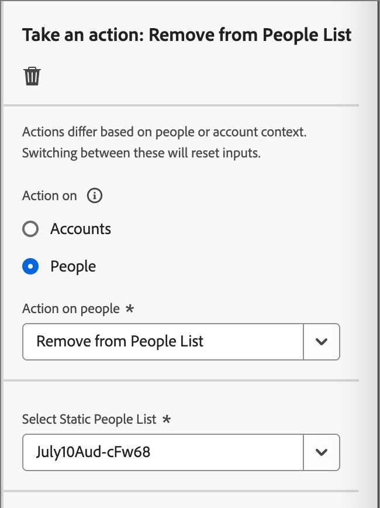

# Usar listas de personas en los recorridos

Existen varias maneras de incorporar [listas de personas](./people-lists.md) a los recorridos de la cuenta y a los recorridos de personas:

* **Mantener una lista estática desde un recorrido** - En un nodo _Realizar una acción_, usar la acción _[!UICONTROL Agregar a la lista de personas]_ o _[!UICONTROL Quitar de la lista de personas]_ para actualizar la pertenencia de una lista de personas estática a medida que las personas se mueven por el recorrido.
* **Enrutar personas según la pertenencia a la lista** - En un nodo de _Rutas divididas_, use el filtro _[!UICONTROL Miembro de persona de la lista estática de personas]_ o _[!UICONTROL Miembro de persona de la lista dinámica de personas]_ para crear una ruta para las personas que son (o no) miembros de una lista.

Por ejemplo, puede crear una lista de exclusión de integrantes del equipo y socios y utilizarla para excluir a esas personas de una ruta de crianza. O puede agregar personas a una lista estática cuando alcancen un punto de calificación en un recorrido y luego utilizar esa lista para ramificar personas en un recorrido diferente.

## Tomar un nodo de acción: agregar a la lista de personas {#add-to-people-list}

**_Solo listas de personas estáticas_**

En un recorrido de cuenta o persona, agregar personas a una lista de personas estáticas mediante [un nodo _Realizar una acción_](../journeys/action-nodes.md#people-actions).

Por ejemplo, considere una ruta de recorrido a la que envíe un correo electrónico y en la que algunas personas se registren para asistir a un seminario web. Considera que esta respuesta es un punto de cualificación en el recorrido. Una vez realizada la calificación, desea agregar estas personas a una lista de personas estáticas que otro recorrido utiliza para dividir las personas calificadas en una ruta diferente.

>[!NOTE]
>
>Si una persona ya está en la lista cuando se ejecuta el nodo, la acción se ignora.

1. Vaya al mapa del recorrido.

1. Haga clic en el icono de signo más ( **+** ) en una ruta y elija **[!UICONTROL Realizar una acción]**.

1. (Solo recorridos de cuenta) Seleccione la opción _[!UICONTROL Acción en]_ **[!UICONTROL Personas]**.

1. Para _[!UICONTROL Acción en personas]_, elija **[!UICONTROL Agregar a la lista de personas]**.

1. Para **[!UICONTROL Seleccionar lista de personas estáticas]**, elija la lista de personas a la que desee agregar personas.

   {width="300"}

## Tomar un nodo de acción: Eliminar de la lista de personas {#remove-from-people-list}

**_Solo listas de personas estáticas_**

En un recorrido de cuenta o persona, quitar personas de una lista de personas estáticas mediante [un nodo _Realizar una acción_](../journeys/action-nodes.md#people-actions).

Por ejemplo, una vez que una persona se convierte, desea eliminarla de una lista estática. Esta lista se usa para dirigir a las personas a un camino de crianza para que ya no reciban comunicaciones de crianza.

>[!NOTE]
>
>Si una persona no está en la lista de la que está programada para su eliminación, la acción se ignora.

1. Vaya al mapa del recorrido.

1. Haga clic en el icono de signo más ( **+** ) en una ruta y elija **[!UICONTROL Realizar una acción]**.

1. (Solo recorridos de cuenta) Seleccione la opción _[!UICONTROL Acción en]_ **[!UICONTROL Personas]**.

1. Para _[!UICONTROL Acción en personas]_, elija **[!UICONTROL Quitar de la lista de personas]**.

1. Para **[!UICONTROL Seleccionar lista de personas estáticas]**, elija la lista de personas de la que desea quitar personas.

   {width="300"}

## Nodo de rutas divididas: miembro de la lista de personas {#split-paths-by-list-membership}

**_recorridos de cuenta y persona_**

Use los filtros de pertenencia a listas de personas en un nodo [_Split paths_](../journeys/split-merge-paths-nodes.md) para enrutar a las personas en función de si son miembros de una lista de personas. Hay dos filtros disponibles:

| Filtro | Descripción |
| ------ | ----------- |
| [!UICONTROL Miembro de persona de la lista dinámica de personas] | La persona es o no miembro de una o más listas dinámicas de personas. La pertenencia refleja las reglas actuales de la lista. |
| [!UICONTROL Lista estática de miembros de persona de personas] | La persona es o no miembro de una o más listas de personas estáticas. |

Estos filtros están disponibles en ambos tipos de recorrido:

* **recorridos de persona** - En un nodo _Dividir rutas_.
* **recorridos de cuenta** - En un nodo _Dividir rutas_ que se divide entre _[!UICONTROL Personas]_.

Para excluir miembros del equipo y socios de una ruta de acceso de referencia, agregue el filtro _[!UICONTROL Miembro de persona de la lista estática de personas]_, establezca el operador en `is not` y seleccione la lista.

1. Vaya al mapa del recorrido.

1. Haga clic en el icono de signo más ( **+** ) en una ruta y elija **[!UICONTROL Dividir rutas]**.

   {width="300" zoomable="no"}

1. (Solo recorridos de cuenta) Establezca el nodo para las condiciones de personas.

   * En las propiedades del nodo a la derecha, elija **[!UICONTROL Personas]** para la división.

   * Establezca **[!UICONTROL Atributos usados para condiciones]** en **[!UICONTROL Solo atributos de personas]**.

   {width="300" zoomable="no"}

1. Para definir una condición para _[!UICONTROL Ruta 1]_, haga clic en **[!UICONTROL Aplicar condición]**.

1. En el editor de condiciones, expanda la carpeta _[!UICONTROL Filtros especiales]_ y arrastre el filtro **[!UICONTROL Miembro de persona de la lista dinámica de personas]** o **[!UICONTROL Miembro de persona de la lista estática de personas]** al área de trabajo de condiciones.

   {width="700" zoomable="yes"}

1. Para incluir miembros de la lista, establezca la pertenencia en `is`.

   Para excluirlos, establézcalo en `is not`.

1. Seleccione la lista de personas que desea evaluar.

   Introduzca texto en el campo para filtrar las listas disponibles. Solo las listas de personas creadas por el usuario están disponibles para su selección.

1. Refine las condiciones aplicando la **[!UICONTROL lógica de filtro]** en la parte superior.

   Puede combinar los filtros de pertenencia a listas con los filtros de otras personas y elegir hacer coincidir todas las condiciones o cualquier condición.

1. Haga clic en **[!UICONTROL Finalizado]**.

Continúe configurando el nodo de rutas divididas como se describe en [_Agregar una ruta dividida por el nodo de personas_](../journeys/split-merge-paths-nodes.md#add-a-split-path-by-people-node). Para obtener más información acerca de los filtros de pertenencia, vea [_Filtro de pertenencia_](../journeys/split-merge-paths-nodes.md#membership-filtering).
