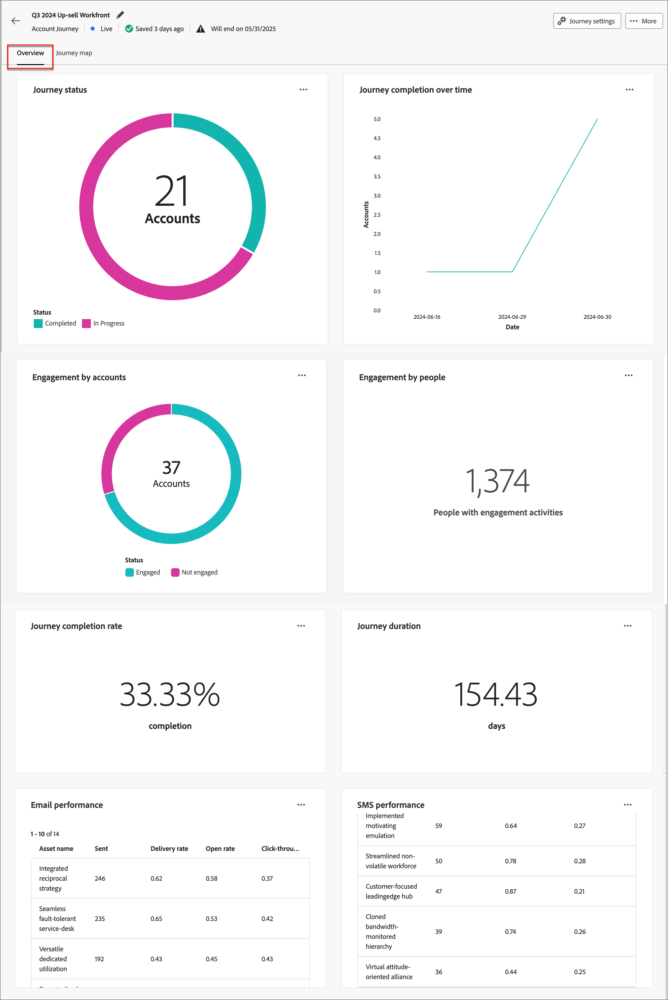
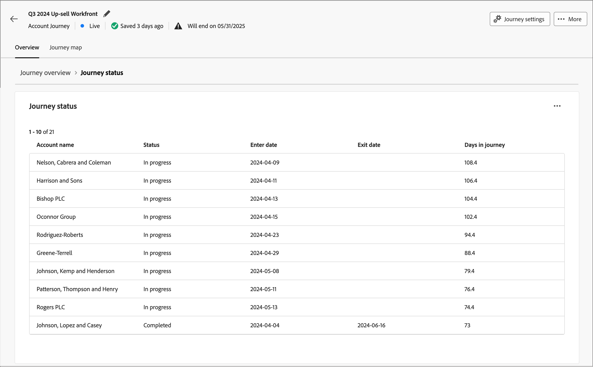
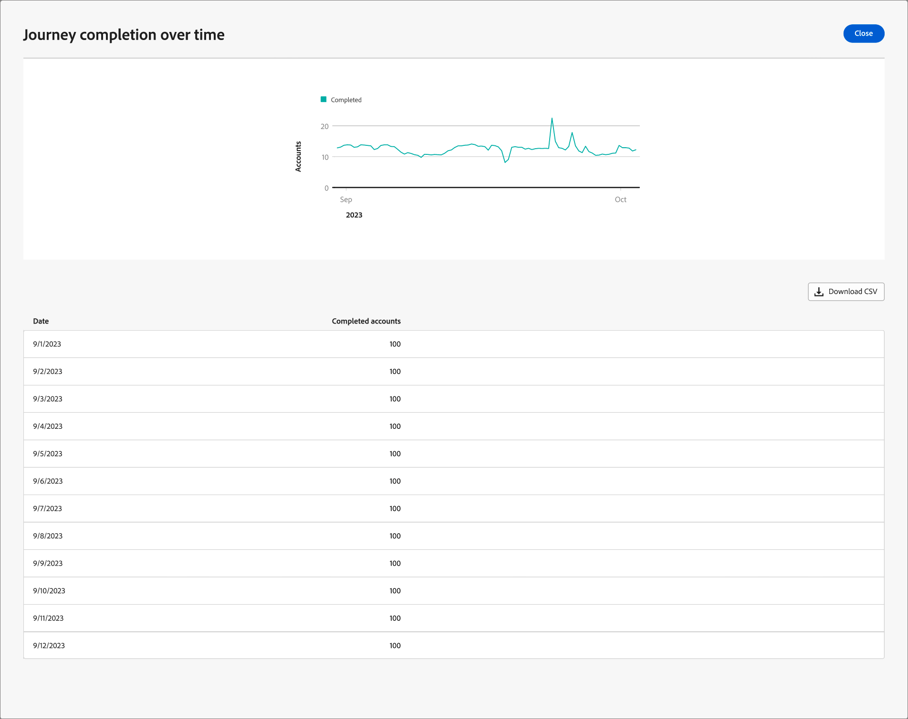
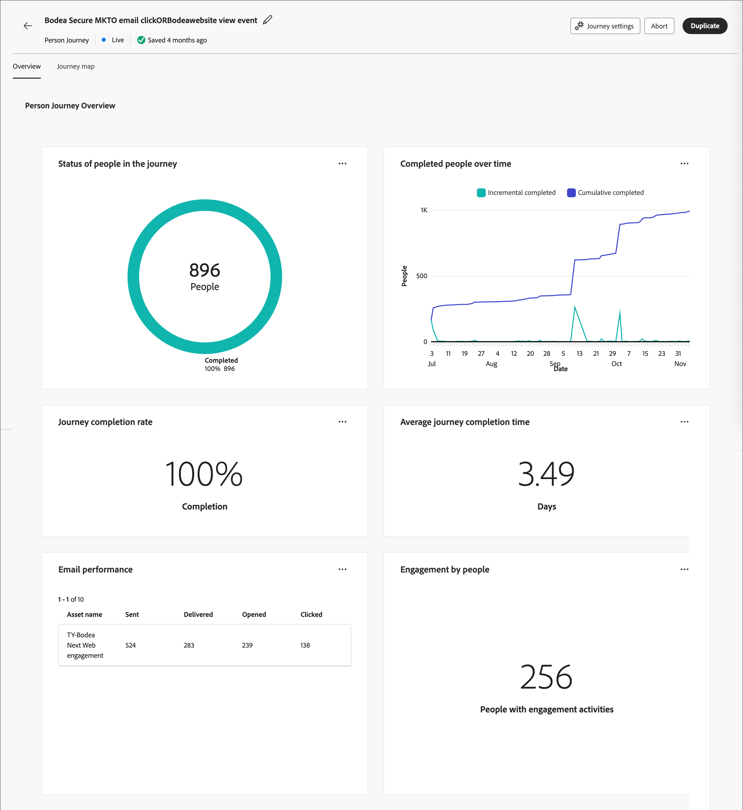

# Detalles del recorrido

En [!DNL Adobe Journey Optimizer B2B Edition], abra una cuenta publicada o un recorrido de persona y seleccione la pestaña **[!UICONTROL Información general]**. Revise el progreso, la participación y el rendimiento del canal del recorrido seleccionado.

Los recorridos de cuenta informan del progreso de las cuentas. Los recorridos de personas informan del progreso de las personas. Los widgets y las etiquetas de métricas disponibles difieren según el tipo de recorrido. Seleccione la pestaña correspondiente para ver los detalles del panel.

Para las métricas de correo electrónico agregadas en los recorridos, usa el [informe de rendimiento de correo electrónico](../dashboards/email-performance-dashboard.md).

>[!BEGINTABS]

>[!TAB recorridos de cuenta]

El panel de recorrido de cuentas muestra el progreso de la cuenta, la participación, el rendimiento del canal y los resúmenes de IA generativos. Los datos tardan aproximadamente cuatro horas en empezar a rellenar los gráficos y tablas.

{width="700" zoomable="yes"}

## finalización del recorrido

Esta sección presenta dos métricas de finalización:

* **[!UICONTROL Estado de las cuentas en el recorrido]**: Muestra el recuento total de cuentas y un desglose por estado de recorrido, que incluye _Finalizado_, _En curso_ y _Anulado_. Cada segmento muestra un estado, un porcentaje y un recuento de cuentas.
* **[!UICONTROL Cuentas completadas a lo largo del tiempo]**: Muestra el número de cuentas que completaron el recorrido a lo largo del tiempo. El eje horizontal muestra fechas y el eje vertical muestra recuentos de cuentas.

>[!NOTE]
>
>En los recorridos de cuentas, el gráfico **[!UICONTROL Estado de las cuentas del recorrido]** incluye las cuentas que pasaron por el recorrido, incluso si se eliminaron posteriormente. **[!UICONTROL Explorar en profundidad]** excluye las cuentas eliminadas, por lo que puede mostrar menos registros que el gráfico. Se espera esta diferencia. La eliminación de cuentas no cambia los recuentos de estado de los recorridos históricos.

## participación de recorrido

Esta sección presenta dos métricas de participación:

* **[!UICONTROL Participación por cuentas]**: este gráfico circular segmenta las cuentas de un recorrido en las categorías _Participado_ y _No comprometido_. La figura central muestra el recuento total. Esta visualización proporciona una comprensión rápida de la participación general de la cuenta.
* **[!UICONTROL Participación de personas]**: Muestra el número de personas con actividades de participación en el recorrido. Este valor cuenta las personas, no las actividades de participación.

## rendimiento del recorrido

Esta sección presenta dos métricas vitales:

* **[!UICONTROL Tasa de finalización de Recorridos]** - Porcentaje de cuentas que han completado correctamente su recorrido.
* **[!UICONTROL Tiempo promedio de finalización de recorridos]**: El tiempo promedio que tardaron las cuentas en completar el recorrido, mostrado en días.

## Rendimiento de canal {#email-and-sms-performance}

El tablero incluye **[!UICONTROL rendimiento de correo electrónico]**, **[!UICONTROL rendimiento de SMS]** y **[!UICONTROL rendimiento de WhatsApp]** tablas para el recorrido de cuenta seleccionado. Utilice las métricas de entrega y participación disponibles para evaluar cada punto de contacto de comunicación.

**[!UICONTROL Rendimiento de correo electrónico]** columnas de tabla:

* _[!UICONTROL Nombre del recurso]_ - Nombre del recurso
* _[!UICONTROL Enviado]_ - Cantidad de correos electrónicos enviados
* _[!UICONTROL Tasa de entrega]_ - Número de correos electrónicos enviados dividido por el número de correos electrónicos enviados
* _[!UICONTROL Tasa de apertura]_ - Número de correos electrónicos abiertos dividido por el número de envíos
* _[!UICONTROL Tasa de clics]_: número de correos electrónicos en los que se hizo clic dividido por el número de envíos

**[!UICONTROL Rendimiento de SMS]** columnas de tabla:

* _[!UICONTROL Nombre del recurso]_ - Nombre del recurso
* _[!UICONTROL Enviado]_ - Número de mensajes SMS enviados
* _[!UICONTROL Tasa de entrega]_: número de mensajes SMS enviados dividido por el número enviado
* _[!UICONTROL Tasa de clics]_: número de mensajes SMS en los que se hizo clic dividido por el número entregado
<!--
To generate a shareable PDF of your current view, click **[!UICONTROL Export]** at the top right of the page. 
-->

## Acciones adicionales

Utilice el menú **...** de un gráfico o tabla para acceder a sus acciones disponibles.

### Explorar en profundidad

Para el gráfico **[!UICONTROL Estado de las cuentas en el recorrido]**, elija **[!UICONTROL Obtener detalles]** para un análisis detallado de los estados de las cuentas individuales.

{width="600" zoomable="yes"}
<!--
The applied global filters are carried over to the view and displayed at the top. Click the _Filter_ icon at the top left to filter the data display by journey.
-->

### Ver más

Elija **[!UICONTROL Ver más]** para acceder a los datos extendidos. La ventana emergente que se muestra proporciona un desglose de los datos.

{width="600" zoomable="yes"}

Para descargar los datos, seleccione **[!UICONTROL Descargar CSV]**. Para volver al panel _[!UICONTROL Información general]_, seleccione **[!UICONTROL Cerrar]**.

>[!TAB recorridos de personas]

El panel de recorrido de personas muestra la finalización, la participación y el rendimiento del correo electrónico de las personas en el recorrido seleccionado.

{width="700" zoomable="yes"}

## finalización del recorrido {#person-journey-completion}

Utilice los gráficos siguientes para revisar el estado de las personas en las tendencias de recorrido y finalización:

* **[!UICONTROL Estado de las personas en el recorrido]**: muestra el número total de personas y un desglose por estado de recorrido. Cada segmento muestra un estado, un porcentaje y un recuento de personas.
* **[!UICONTROL Personas completadas a lo largo del tiempo]**: Muestra el número de personas que completaron el recorrido a lo largo del tiempo. La serie **[!UICONTROL Incremental completado]** muestra las finalizaciones de cada intervalo de tiempo. La serie **[!UICONTROL Acumulativa completada]** muestra el total actual de finalizaciones.

>[!NOTE]
>
>En los recorridos de personas, el gráfico **[!UICONTROL Estado de las personas en el recorrido]** incluye a las personas que pasaron por el recorrido, incluso si se eliminaron posteriormente. **[!UICONTROL Explorar en profundidad]** excluye a las personas eliminadas, por lo que puede mostrar menos registros que el gráfico. Se espera esta diferencia. Eliminar personas no cambia los recuentos del estado del recorrido histórico.

Para el estado de _[!UICONTROL las personas en el recorrido ], haga clic en el icono_ Más_ ( **...** ) y seleccione **[!UICONTROL Obtener detalles]** para revisar los estados individuales de las personas.

## participación de recorrido {#person-journey-engagement}

El widget **[!UICONTROL Participación de personas]** muestra el número de personas con actividades de participación en el recorrido. Este valor cuenta las personas, no las actividades de participación.

## rendimiento del recorrido {#person-journey-performance}

Utilice las siguientes métricas para revisar el rendimiento de finalización:

* **[!UICONTROL Tasa de finalización de Recorridos]**: Porcentaje de personas que completaron el recorrido.
* **[!UICONTROL Tiempo promedio de finalización de recorridos]**: El tiempo promedio que tardaron las personas en completar el recorrido, mostrado en días.

## Rendimiento del correo electrónico {#person-journey-email-performance}

La tabla **[!UICONTROL Rendimiento del correo electrónico]** muestra recuentos para cada recurso de correo electrónico en el recorrido de persona seleccionado, en lugar de tasas:

* **[!UICONTROL Nombre del recurso]**: Nombre del recurso de correo electrónico
* **[!UICONTROL Enviado]**: número de correos electrónicos enviados
* **[!UICONTROL Entregado]**: Número de correos electrónicos entregados
* **[!UICONTROL Abierto]**: Número de correos electrónicos abiertos
* **[!UICONTROL Se hizo clic]**: Número de correos electrónicos en los que se hizo clic

>[!ENDTABS]
